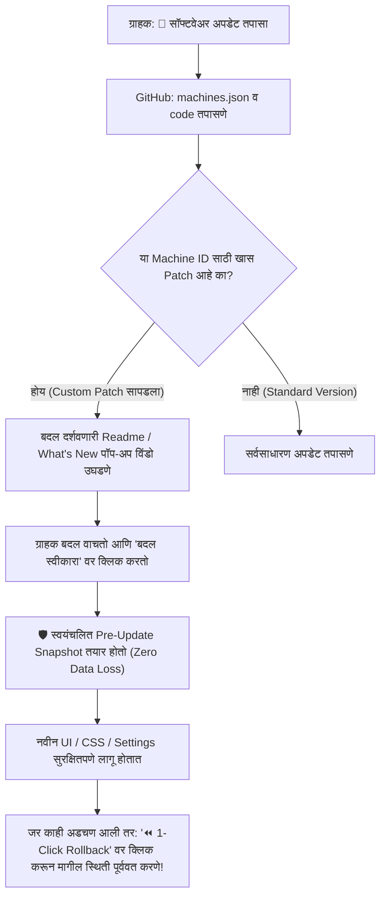

# कृषी केंद्र बिलिंग सॉफ्टवेअर: क्लायंट-विशिष्ट अपडेट्स, Readme रिव्ह्यू आणि 1-Click रोलबॅक मार्गदर्शक
## (Krishi Kendra Billing: Machine-Specific OTA, Update Readme & Zero Data Loss Rollback Guide)

---

## १. प्रणालीचे विहंगावलोकन (System Architecture Overview)

या आवृत्तीत ग्राहकांचा जुना डेटा (बिल्स, शेतकरी यादी, उधारी, स्टॉक) सुरक्षित ठेवण्यासाठी आणि ठराविक ग्राहकाला त्यांच्या मशिन आयडीनुसार खास बदल (Custom UI/Theme/Settings) पाठवण्यासाठी खालील ३ शक्तिशाली प्रणाली जोडल्या आहेत:



---

## २. 1-Click Pre-Update Snapshot आणि Rollback कसे कार्य करते? (Zero Data Loss Rollback)

ग्राहक जेव्हाही **"बदल स्वीकारा व लागू करा"** किंवा **"सॉफ्टवेअर अपडेट"** बटनावर क्लिक करतो, तेव्हा सॉफ्टवेअर कोणताही नवीन बदल लागू करण्यापूर्वी **१ मायक्रोसेकंद आधी** ग्राहकाच्या सर्व डेटाचा सुरक्षित स्नॅपशॉट `localStorage.kk_rollback_snapshot` मध्ये जतन करतो:

### स्नॅपशॉटमध्ये काय साठवले जाते?
1. **सर्व बिले व विक्री इतिहास (`history`)**: ग्राहकाचे जुने एकही बिल डिलीट होत नाही.
2. **शेतकरी खातेवही व उधारी (`farmers` & `khata`)**: सर्व शेतकऱ्यांची उधारी व जमा जमाखर्च.
3. **गोदाम साठा (`inventory`)**: सर्व खते, बियाणे आणि औषधांचा स्टॉक.
4. **दुकान सेटिंग्ज (`settings`)**: दुकानाचे नाव, पत्ता, मोबाईल, GST, बँक माहिती.
5. **मागील व्हर्जन व पॅच आयडी (`patchId` & `version`)**.

### रोलबॅक कसा करायचा? (How to Rollback)
1. **अपडेट व बॅकअप (Updates & Backup)** टॅब उघडा.
2. **"⏪ मागील आवृत्तीवर परत जा (1-Click Rollback)"** बटनावर क्लिक करा.
3. सिस्टीम पॉप-अपमध्ये आधीच्या स्नॅपशॉटची माहिती दाखवेल (तारीख, वेळेसह किती बिले आणि शेतकरी रिस्टोअर होतील).
4. ग्राहकाने **"OK"** केले की, १ सेकंदात सॉफ्टवेअर अपडेट आधीच्या स्थितीत १००% पूर्ववत होते!

---

## ३. विशिष्ट ग्राहकाला (Machine ID) खास बदल कसे पाठवायचे? (Custom Machine Fork OTA)

तुम्हाला एखाद्या विशिष्ट दुकानदारासाठी खास बदल (जसे की दुकानाची खास थीम, रंग, प्रिंट सेटिंग्ज, किंवा अतिरिक्त फीचर्स) द्यायचे असल्यास, तुम्हाला फक्त तुमच्या GitHub रिपॉझिटरीमधील [machines.json](file:///C:/Users/rupam/.gemini/antigravity-cli/brain/ba6e8a7f-fa09-4a8e-8b7f-bfcb7ac832b9/krishi-kendra-repo/machines.json) मध्ये त्या मशिन आयडी अंतर्गत `"patch"` ऑब्जेक्ट जोडायचा आहे:

### `machines.json` मधील उदाहरण:
```json
{
  "machines": {
    "KK-A1B2-C3D4": {
      "storeName": "श्री गजानन कृषी सेवा केंद्र",
      "ownerName": "रमेश पाटील",
      "mobile": "9876543210",
      "status": "active",
      "patch": {
        "patchId": "PATCH-GAJANAN-01",
        "version": "1.0.1",
        "releaseDate": "2026-11-15",
        "title": "श्री गजानन कृषी केंद्र - सानुकूल रंगसंगती व पावती बदल",
        "readme": [
          "दुकानदाराच्या पसंतीनुसार हिरवा व सोनेरी प्रीमियम हेडर रंग लागू केला.",
          "पावतीवर प्रोप्रायटर रमेश पाटील यांचे नाव आणि विशेष QR कोड मोठा केला.",
          "खत खरेदीवर लॉयल्टी डिस्काउंट गणना स्वयंचलित केली."
        ],
        "customCss": ":root { --primary-gradient: linear-gradient(135deg, #1b5e20, #fbc02d) !important; } .header-badge { border: 2px solid #fbc02d !important; }",
        "customSettings": {
          "receiptCustomFooter": "आमच्याकडे भेट दिल्याबद्दल धन्यवाद! पुन्हा या!"
        }
      }
    }
  }
}
```

### जेव्हा तो ग्राहक अपडेट करेल तेव्हा काय दिसेल?
1. ग्राहक **"🚀 सॉफ्टवेअर अपडेट तपासा"** बटनावर क्लिक करेल.
2. सिस्टीम त्याचा Machine ID तपासेल आणि त्याच्या स्क्रीनवर एक देखणा **"सानुकूल सॉफ्टवेअर बदल (Custom Machine Update)"** डायलॉग उघडेल.
3. त्यामध्ये त्याचे **Machine ID**, **Patch Title**, आणि तुम्ही दिलेले **Readme मुद्दे (Bullet points)** स्पष्ट मराठीत दिसतील.
4. खाली हिरवे **"✅ बदल स्वीकारा व लागू करा"** बटण दिसेल.
5. ग्राहकाने क्लिक करताच त्याचा डेटा सुरक्षित ठेवून ते बदल त्वरित लागू होतील!
6. इतर कोणत्याही ग्राहकाच्या मशिनवर हे बदल दिसणार नाहीत (Isolated Forking).

---

## ४. ग्राहक डेव्हलपरशी बदल कसे मागवू शकतात? (Developer WhatsApp Bridge)

अपडेट टॅबमध्ये ग्राहकांसाठी **"📞 डेव्हलपरशी संपर्क (WhatsApp वर बदल सांगा)"** हे बटण दिले आहे:
- यावर क्लिक करताच ग्राहकाच्या व्हॉट्सॲपमध्ये थेट खालीलप्रमाणे तयार मेसेज उघडतो:
  > *"नमस्कार, मला कृषी केंद्र सॉफ्टवेअरमध्ये काही बदल हवे आहेत.*  
  > *माझे दुकान: [दुकान नाव]*  
  > *Machine ID: KK-XXXX-XXXX*  
  > *Current Version: 1.0.0"*
- यामुळे तुम्हाला त्या ग्राहकाचा अचूक Machine ID लगेच समजतो आणि तुम्ही `machines.json` मध्ये त्याच्यासाठी खास पॅच तयार करू शकता.

---

## ५. सुरक्षा आणि अँटी-हॅक हार्डनिंग (Anti-Tamper Hardening)

ग्राहकांनी सॉफ्टवेअरचा गैरवापर किंवा ट्रायल पिरियड रीसेट करू नये म्हणून खालील सुरक्षा उपाय कायम आहेत:
1. **GitHub URLs आणि कच्चा JSON लपवला**: ग्राहकाला बॅकएंडच्या क्लिष्ट लिंक्स किंवा फाइल्स दिसत नाहीत; फक्त आवश्यक आणि सुरक्षित बटणे दिसतात.
2. **SHA-256 सिग्नेचर सिक्युरिटी**: `kk_install_date` आणि `kk_license_key` ब्राऊझरच्या `localStorage` मध्ये कोणी मॅन्युअली बदलल्यास सिस्टीम त्वरित छेडछाड (Tampering) ओळखून ॲप लॉक करते.
3. **१००% ऑफलाइन क्षमता**: इंटरनेट नसतानाही बिलिंग, स्टॉक, शेतकरी खाती अविरत सुरू राहतात.
